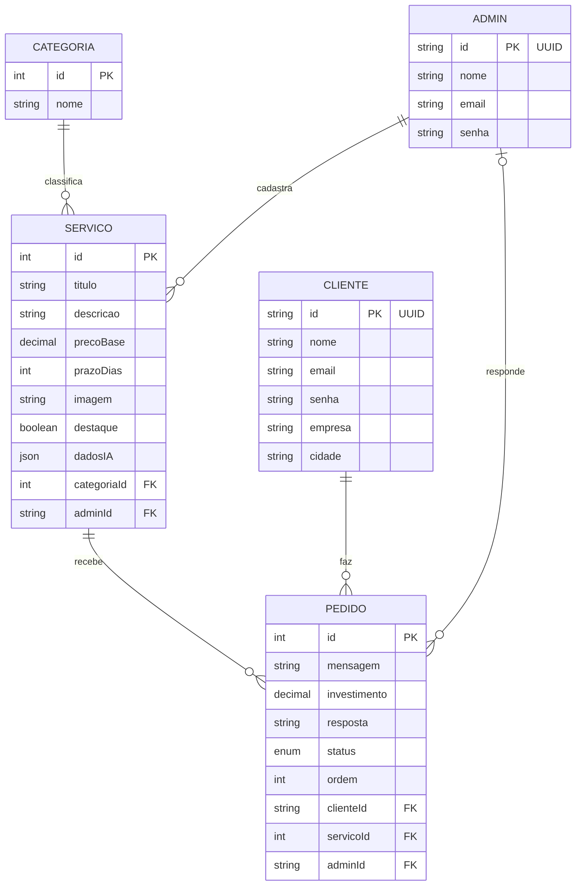

# WAW Orçamentos

Sistema full stack em que clientes conhecem os serviços da WAW Studio e pedem orçamentos, e a equipe responde e acompanha cada pedido em um quadro arrastável. Une o Trabalho #1 (Linguagens de Programação Emergentes) e o Trabalho #2 (Programação Full Stack, pacote dnd-kit), UniSenac Pelotas. Preços, clientes e pedidos do seed são fictícios.

## Tecnologias

- Back-end: Node, Express, Prisma, PostgreSQL, Zod, Bcrypt, JsonWebToken, Nodemailer, Claude API
- Front-end: React, Vite, React Router, React Hook Form, Zustand, SweetAlert2, Victory, dnd-kit

## Pacote do Trabalho #2: dnd-kit

- Exemplo mínimo: [frontend/src/exemplos/ListaSimples.tsx](frontend/src/exemplos/ListaSimples.tsx), na rota `/exemplo-dnd`
- Caso real, com várias colunas e gravação na API: [frontend/src/admin/Quadro.tsx](frontend/src/admin/Quadro.tsx), na rota `/admin/quadro`
- Apresentação: [apresentacao/dnd-kit-waw-orcamentos.pptx](apresentacao/dnd-kit-waw-orcamentos.pptx)

## Modelo E-R



## Como rodar localmente

```bash
docker compose up -d
```

```bash
cd backend
npm install
cp .env.example .env
npx prisma migrate deploy
npm run seed
npm run dev
```

```bash
cd frontend
npm install
cp .env.example .env
npm run dev
```

O site abre em `http://localhost:5175` e a API em `http://localhost:3333`. As credenciais de teste do admin estão em `backend/.env.example`.

## Variáveis de ambiente

| Onde | Variável | Para que serve |
| --- | --- | --- |
| backend | `DATABASE_URL` | Conexão com o PostgreSQL |
| backend | `JWT_SECRET` | Assinatura dos tokens de login |
| backend | `FRONTEND_URL` | Endereços do front autorizados no CORS |
| backend | `ANTHROPIC_API_KEY` | Consulta à IA. Vazia: o sistema funciona sem os dados de IA |
| backend | `CLAUDE_MODEL` | Opcional. Troca o modelo da Claude (padrão `claude-opus-5-5`) |
| backend | `SMTP_*` | Envio de e-mail. `SMTP_HOST` vazio: a resposta só aparece no sistema |
| backend | `ADMIN_NOME`, `ADMIN_EMAIL`, `ADMIN_SENHA` | Primeiro administrador, criado pelo seed |
| frontend | `VITE_API_URL` | Endereço da API |
